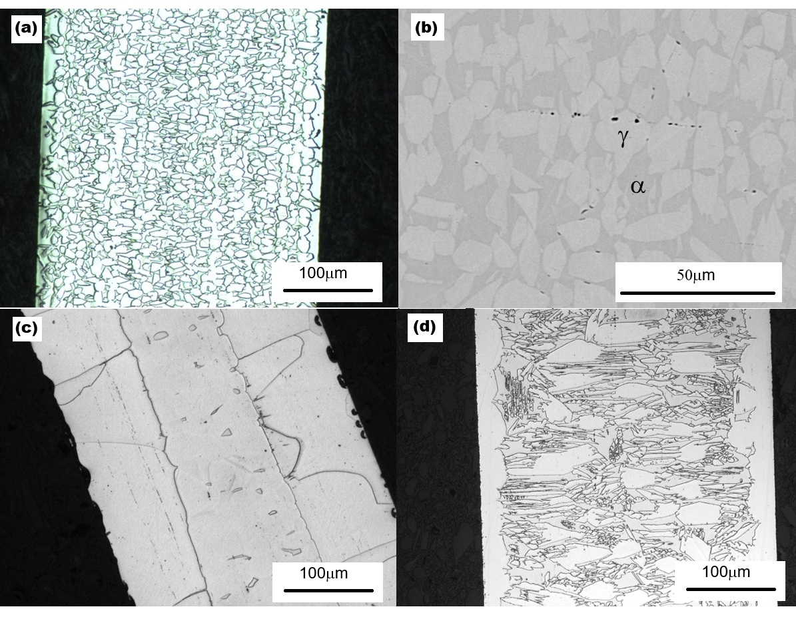

# Abstract

Iron-based shape memory alloys (Fe-SMAs) offer a low-cost alternative to Nitinol, but their superelastic response is sensitive to composition and processing. Large language model (LLM) deep-research agents can propose alloy compositions in seconds, but whether such proposals work once synthesized is rarely tested. We synthesized and tested one Fe-Mn-Al-Ni-Si-C composition drawn from an LLM proposal, alongside an Fe-Mn-Al-Ni reference alloy of established superelastic composition, processed in parallel. The LLM-hypothesized alloy showed no superelasticity where unloading was recorded and no shape-memory recovery on heating in the one condition tested, whereas the reference alloy recovered ≈0.5%. After a 1200 °C anneal, ex-situ synchrotron X-ray diffraction with semi-quantitative Rietveld refinement indicates a γ-majority FCC γ + BCC α structure with a minor ordered phase indexed as D0₃ Fe₃Al, unchanged after 10% strain. Equilibrium calculations in three CALPHAD databases find no single-phase α field below the alloy's melting point; one opens when its 0.1 wt% carbon is removed, making carbon a plausible contributor rather than a demonstrated cause. The workflow omitted the phase-stability check its own report recommended. This single-composition case study does not evaluate LLM alloy design in general; proposed compositions should be screened for competing-phase stability before synthesis.

**Keywords:** abnormal grain growth; alloy design; CALPHAD; Fe-based shape memory alloy; large language model; superelasticity; synchrotron XRD

---

# 1. Introduction

Deep-learning models trained on first-principles thermodynamics have advanced materials discovery. For example, DeepMind's GNoME predicted more than 2.2 million previously unreported crystal structures with high precision against DFT validation [@merchant2023gnome]. In addition, agentic large language models (LLMs) with deep-research capabilities can ingest decades of metallurgical literature and propose compositions in seconds [@comanici2025gemini; @xu2025deepresearch]. Together, these tools raise the possibility of alloy design that supplements intuition-guided iteration with machine-proposed candidates: some screened against first-principles thermodynamics, as GNoME's are against DFT, and others, like the LLM proposal examined here, screened by no calculation at all (Sec. 2.1). Recent studies have begun applying such AI methods specifically to shape memory alloys (SMAs), including data-driven composition screening [@aims2022], generative inverse design [@generativeinversion2025], and LLM-based hypothesis generation [@hu2024beyond]. However, experimental tests of such proposals, and of LLM-generated ones in particular, remain few. Current generative materials models typically optimize for thermodynamic stability (formation energy, convex-hull distance) but may not, in general, explicitly consider the kinetic barriers that govern microstructure evolution during processing [@merchant2023gnome]. A composition whose target phase lies on the DFT convex hull might still be difficult to realize in practice. This study examines an LLM-hypothesized SMA. To the best of our knowledge, experimental validation of such alloys remains very rare.

SMAs exhibit reversible martensitic transformations that enable two technologically important behaviors: the shape memory effect, in which thermally induced phase changes recover macroscopic deformation, and superelasticity, in which stress-induced martensite reverts upon unloading [@otsuka2005physical; @lagoudas2008shape]. As the dominant commercial SMA, Nitinol (a near 50Ni-50Ti alloy) offers large recoverable strains of 6–8%, excellent cyclic stability, and biocompatibility, properties that have led to its wide use in medical devices, aerospace actuators, and damping applications [@duerig1999overview; @mohd2014nitinol]. However, because of its relatively high manufacturing cost, the use of Nitinol in structural engineering applications, such as prestressing tendons for concrete and seismic dampers, remains very limited.

Fe-based SMAs offer a path to lower cost [@cladera2014ironbased]. Omori *et al.* found that certain Fe-Mn-Al-Ni alloys were capable of large strain recovery at room temperature after abnormal grain growth (AGG) [@omori2011superelastic], in which cyclic heat treatments across the FCC γ ↔ BCC α phase boundary produce a bamboo-like grain structure, with individual grains spanning the whole wire cross-section. Subsequent studies have associated such large grains with reduced intergranular constraint and improved transformation reversibility in the BCC α / FCC γ system [@vollmer2016cyclic; @abuzaid2019femnnial]. However, achieving a bamboo-like grain structure poses significant challenges, especially at industrial scale. In this study, we took this alloy system as the starting point and asked an LLM deep-research agent for lower-cost alternatives with the potential to exhibit superelasticity. The agent retrieves and reads published and web sources at query time rather than being trained on a curated corpus; its report draws on 76 sources (Sec. 2.1). We processed one of the LLM-hypothesized compositions alongside the alloy reported by Omori *et al.* [@omori2011superelastic]; preliminary results were reported at SMST 2026 [@cai2026smst]. Both alloys followed the same nominal processing route. Identical nominal parameters do not guarantee identical recrystallization, grain size, texture or precipitation in two different compositions, so what follows compares how each alloy responds to a common route rather than isolating composition as the only variable (Sec. 4.1). This work is an exploratory case study of one LLM-assisted hypothesis, not an evaluation of LLM alloy design as a class.

---

# 2. Materials and Experiments

## 2.1 Alloy design and synthesis

The LLM-hypothesized composition originated in a Gemini 2.5 Deep Research session [@comanici2025gemini], in which the agent searched for and read sources at query time; no model was trained or fine-tuned for this work. The agent was asked for iron-based compositions that might approach Nitinol-like pseudoelasticity at substantially lower cost, reasoning from the Fe-Mn-Al-Ni family established by Omori and co-workers [@omori2011superelastic; @omori2017martensitic] and excluding expensive additions such as cobalt and tantalum. Its report, *New Fe-SMA Alloy Hypotheses* (41 pages drawing on 76 sources, all accessed on 19 May 2025; exported on 4 June 2025), is supplied unedited as Online Resource 1. The verbatim prompt was not preserved, and the report does not include it; the report is therefore the complete surviving record of the session. The request was made in this single session and was not repeated. The agent ran no thermodynamic or first-principles calculation; its report recommends CALPHAD and DFT calculations as future steps (Sec. 4.3). The report proposes six candidate families and ranks them by experimental priority: three Fe-Mn-Al-(Ni) variants, two Fe-Mn-Si-Cr variants, and one Fe-Al-Cr-Mn interstitial alloy.

The composition made here was drawn from Hypothesis A2, Fe-Mn-Al-Si-Ni-(B/C), which the report ranks tied for second of the six with Hypothesis A1, Fe-Mn-Al-(low Ni)-Cr-(C/V). The first-ranked candidate, Hypothesis B1, is an Fe-Mn-Si-Cr-V-C alloy that relies on a different transformation, from FCC austenite to HCP ε martensite; it was not synthesized. We chose A2 because it builds on the Fe-Mn-Al-Ni system, for which a substantial body of earlier work exists [@omori2011superelastic; @omori2017martensitic]. An alloy of established composition from that system could therefore be processed alongside it as a reference, and the results could be compared directly with the published record. Of the two Fe-Mn-Al-Ni-based hypotheses, A2 adds no chromium, contains more nickel than A1 (3–6 against 2–5 wt%), and has the highest recoverable-strain target of the six. A2's proposed range is Fe (bal.), Mn 20–30, Al 8–12, Si 1–4, Ni 3–6, and either B 0.005–0.05 or C 0.1–0.3, all in wt%. We specified the composition in atomic percent, the basis on which the Fe-Mn-Al-Ni alloys of that earlier work are reported, and took A2's carbon option rather than its boron one: 50Fe-30Mn-12Al-4Ni-4Si (at%) with an additional 1000 ppm C, equivalent to 54.5Fe-32.3Mn-6.4Al-4.6Ni-2.2Si-0.1C (wt%). The manganese, aluminum and silicon values are the upper limits of A2's ranges, and the nickel value lies within its range, but these values were applied as atomic rather than weight percentages. The composition therefore lies within A2 for silicon, nickel and carbon but outside it for manganese (32.3 wt% against a ceiling of 30) and aluminum (6.4 wt% against a floor of 8). Both deviations lie in the austenite-forming direction, toward the outcome actually observed. The experiments thus test the composition that was made, not Hypothesis A2 as a whole; the A2 range is examined only by calculation (Sec. 3.4).

In the report's rationale for A2, Fe, Mn, Al, and Ni are intended to form a BCC parent phase and β (NiAl-type) precipitates, with Ni kept moderate to lower cost. Si is added for solid-solution strengthening of the parent BCC matrix; it is also known to increase slip resistance in ferritic structures and could potentially modify the stability or morphology of β precipitates or influence the stacking-fault energy. C is added for interstitial strengthening of the parent phase and for the possible formation of very fine, dispersed carbides. The report's stated performance target for A2 is 5–8% recoverable strain at a transformation stress of 400–700 MPa. For direct comparison, a second alloy of composition 43.5Fe-34Mn-15Al-7.5Ni (at%), based on the work of Omori *et al.* [@omori2011superelastic], was synthesized and processed in parallel. These alloys are hereafter referred to as the LLM alloy and the Omori alloy, respectively. The Omori alloy serves as a reference composition processed in parallel, not as an optimally treated superelastic control. It received the same nominal route as the LLM alloy and is compared in the 1200 °C/1 min condition used throughout the anneal series, not after the abnormal-grain-growth and aging route by which this composition attains its superelasticity [@omori2011superelastic]. The transformation it showed under the common route (Sec. 3.2) is used as evidence that the route and the tests can detect one, not as a demonstration of that superelasticity.

About 2 kg of each alloy was melted from high-purity raw elements in a vacuum induction furnace and cast into ø50 mm ingots. The alloy chemistries, measured by inductively coupled plasma atomic emission spectroscopy (ICP-AES), with carbon determined by ASTM E1019, are listed in wt% and at% in **Table 1**. The measured composition of the Omori alloy, 42.7Fe-34.1Mn-15.2Al-7.8Ni (at%), was close to nominal. In the LLM alloy, only about half the intended silicon was recovered, 1.11 wt% against 2.2 wt% (2.04 against 4.0 at%), a shortfall consistent with oxidation loss during vacuum induction melting. The effect of this shortfall on phase stability is examined by calculation in Sec. 3.4. The measured composition of the LLM alloy is therefore 51.5Fe-29.8Mn-11.9Al-4.2Ni-2.0Si-0.45C (at%), and this composition was used in all calculations. Each heat was analyzed once, on one sample (Table S1, Online Resource 2), so chemical homogeneity within a heat was not checked. The Omori alloy also contains 0.06 wt% (≈0.10 at%) phosphorus of unknown origin, most plausibly a residual from the melting stock. Phosphorus can segregate to grain boundaries and embrittle them. Its effect on the Omori alloy was not examined, but any such effect could only have degraded the reference behavior, and the Omori alloy still showed a stress-induced transformation (Sec. 3.2). Several ø13 mm rods were cut from the cast ingots by electrical discharge machining (EDM). The rods were homogenized at 1000 °C for 16 hours in an argon atmosphere, hot-rolled at 850 °C in multiple passes to reduce their thickness, and then cold-drawn to wire 0.36 mm in diameter for the LLM alloy and 0.64 mm for the Omori alloy (the test record of the Omori alloy's heating-test specimen gives a diameter of 0.54 mm). Severe work hardening during cold drawing necessitated intermediate annealing at 1000 °C under argon between drawing passes to restore ductility. The cold-drawing reduction after the last process anneal was ≈85% in area.

**Table 1.** Chemical compositions of the two alloys (LLM alloy analyzed on the finished wire, Omori alloy as cast) in wt%, with at% in parentheses, measured by inductively coupled plasma atomic emission spectroscopy (ICP-AES); carbon was determined by ASTM E1019. Atomic percentages are converted from the weight percentages shown and normalized to the elements listed. Each actual value is from a single analysis of one sample per heat (Table S1), and no analytical uncertainty is reported. For the Omori alloy, Fe is given by difference, and other residual elements, each below 0.01 wt%, are not listed. The ICP-AES analysis of the LLM alloy covered only Al, Fe, Mn, Ni and Si, so a dash in its actual column means that the element was not determined.

| Element | LLM alloy (nominal) | LLM alloy (actual) | Omori alloy (nominal) | Omori alloy (actual) |
|---------|---------------------|---------------------|-------------------------|-------------------------|
| Fe      | 54.5 (49.6)         | 55.83 (51.5)        | 47.08 (43.3)            | 46.51 (42.7)            |
| Mn      | 32.3 (29.9)         | 31.78 (29.8)        | 36.43 (34.1)            | 36.49 (34.1)            |
| Al      | 6.4 (12.1)          | 6.24 (11.9)         | 7.9 (15.1)              | 8.00 (15.2)             |
| Ni      | 4.6 (4.0)           | 4.81 (4.2)          | 8.59 (7.5)              | 8.94 (7.8)              |
| Si      | 2.2 (4.0)           | 1.11 (2.04)         | –                       | <0.01 (<0.02)           |
| C       | 0.1 (0.42)          | 0.105 (0.45)        | –                       | 0.01 (0.04)             |
| P       | –                   | –                   | –                       | 0.06 (0.10)             |

## 2.2 Heat treatments

To test the effect of heat-treatment temperature on mechanical properties, cold-drawn 0.36 mm LLM-alloy wires were heat treated in an argon-filled strand furnace at temperatures between 600 and 1200 °C for a nominal dwell of 1 minute and then cooled rapidly to room temperature; the cooling rate on leaving the furnace was not measured. The 1-minute treatments were strand passes through the hot zone, made at 4 ft min⁻¹ for the specimens whose records give the pass speed; the remaining specimens in Table 2 are recorded as having received the same 1-minute treatment (Table S1). "1 minute" is the nominal dwell: the time at temperature, which is set by the pass speed and the hot-zone length, was not measured separately. The Omori alloy wire used in Figs. 3, 4 and 6 received the same 1200 °C/1 min treatment. Static holds of 40 and 80 minutes at 1200 °C were also applied to the LLM-alloy wire. The aged condition of **Fig. 2f** was produced by aging the 1200 °C/1 min wire at 200 °C for 3 hours. Heat treatments above 1200 °C (static holds at 1250 °C and a cyclic exposure at 1300 °C) caused severe oxidation or furnace contamination and are not reported further; 1200 °C was therefore the practical upper limit of the processing window. Surface oxidation and decarburization during the treatments at or below 1200 °C were not measured.

Cyclic heat treatments of the type used to produce abnormal grain growth and a bamboo-like grain structure in this alloy family [@omori2016agg] were also applied to the LLM alloy. Rod ≈1–1.3 mm in diameter was held at 1200 °C for 30 minutes, water quenched, and reheated to 900 °C for 15 minutes. This cycle was applied twice, followed by a final 1200 °C/30 min hold and water quench, or three times, followed by a final 1200 °C/60 min hold and water quench; the three-cycle specimens that were tested mechanically also received the 200 °C/3 h age. In a separate run, 0.36 mm wire sealed in a quartz tube under argon was given four 30-minute holds at 1200 °C, each of the first three followed by 10 minutes in the cold zone of the furnace and the fourth by a water quench.

## 2.3 Metallography

Wire cross-sections were embedded in cold-mount epoxy and ground sequentially with silicon-carbide papers from 180 to 800 grit. Final polishing used a 0.25 µm OP-S aluminum-oxide suspension on an automated polishing wheel until a scratch-free mirror finish was achieved. Polished cross-sections were imaged on a Clemex Vision PE optical microscope under bright-field illumination at magnifications between 100× and 1000×. In addition, scanning electron microscopy (SEM) and energy-dispersive X-ray spectroscopy (EDS) were used to study the microstructure and local chemistry; EDS was used qualitatively (Sec. 3.1).

## 2.4 Mechanical testing

Room-temperature cyclic tensile tests were performed on an Instron testing machine in displacement control. Each specimen was loaded in successive increments of nominally 1% strain and unloaded after each increment until ≈8–12% strain was reached, unless it fractured earlier, and was then loaded to fracture. Specimen handling and the monotonic-tension elements of the procedure broadly followed ASTM E8/E8M. The cyclic protocol itself is not a standardized test but a purpose-designed method, used in our previous work [@cai2024niticu], for evaluating reversible transformation and strain recovery in fine superelastic wire. Unless stated otherwise, the gauge length was 127 mm (5.000 in), and the crosshead speed, where recorded (Table S1), was 0.25 in min⁻¹, corresponding to a nominal strain rate of 8.3 × 10⁻⁴ s⁻¹. Engineering stress was computed from the specimen diameter entered in the instrument record, and engineering strain was taken as the crosshead extension divided by the gauge length, without extensometry. No correction for load-train compliance or grip slip was applied; the elastic portion of each curve therefore includes the load-train compliance, and the moduli in **Table 2** are apparent rather than true. The protocol is designed to reveal superelasticity, which appears as strain recovered on unloading beyond the elastic springback. Three specimens were tested for each condition in **Table 2**; every value in the table is the mean of the three, and the quoted uncertainty is one standard deviation. These properties were determined from the incrementally cycled specimens rather than from separate monotonic tests and therefore depend on the protocol. The aged condition (**Fig. 2f**) was tested on a single specimen, and each prolonged-anneal and cyclically treated condition was tested on one or two specimens (Table S1).

This strain rate is quasi-static. Superelastic alloys are rate-sensitive chiefly because the latent heat of transformation, when it cannot be conducted away fast enough, warms the specimen and raises the stress needed to continue the transformation [@shaw1995niti]. This self-heating effect alters the stress–strain response of a transforming alloy rather than suppressing the transformation, and it is expected to be weaker in Fe-Mn-Al-Ni, whose transformation stress depends only weakly on temperature (0.53 MPa °C⁻¹ [@omori2011superelastic]). The strain rate is therefore not expected to bear on the absence of transformation reported here.

A dedicated loading–unloading–heating test was also conducted on one specimen of each alloy in the 1200 °C/1 min condition to evaluate any shape-memory response. Each specimen was loaded to 3% strain and unloaded to zero stress, after which the crosshead was returned to its starting position (nominal zero strain). At the same time, the specimen was heated to ≈200 °C at ≈50 °C s⁻¹ and held for ≈10 s to trigger any reverse transformation of martensite to austenite; it was then reloaded. Any shape-memory effect would be revealed during the heating stage: it would cause the stress on reloading to rise at a strain lower than the residual strain after unloading.

## 2.5 Synchrotron X-ray diffraction

To identify the phase constitution and any phase change, synchrotron X-ray diffraction (XRD) measurements were performed at the ultra-hard X-ray multifunctional application beamline BL12SW of the Shanghai Synchrotron Radiation Facility (SSRF) [@tai2024ssrf; @yang2024ssrf]. The incident wavelength was λ = 0.12587 Å, and the beam size was 0.5 × 0.5 mm². Patterns were recorded in transmission on a 4288 × 4288-pixel area detector (100 µm pixels) located ≈1.83 m from the specimen. The beam center and the sample-to-detector distance were fitted from the Debye–Scherrer rings themselves and were consistent to better than 0.1% across six indexed rings; a CeO₂ calibrant frame gave the same beam center. Two-dimensional Debye–Scherrer patterns, one or two frames per specimen, were collected from separate specimens of each alloy before and after tensile deformation (10% strain for the LLM alloy, 8% for the Omori alloy) and from the cyclically treated LLM-alloy rod (Sec. 3.3). The deformed specimens were measured after unloading, at zero load. One specimen was measured per alloy and condition (Table S1). The 2D images were processed in FIT2D [@hammersley1998fit2d]: the diffraction data were sliced at 5° intervals around the 360° azimuth and integrated to give 72 diffraction spectra, which were then fitted by Rietveld refinement [@rietveld1969] in MAUD version 2.33 [@lutterotti1997maud].

For each LLM-alloy pattern, undeformed and after 10% strain, all 72 spectra were refined simultaneously against a three-phase model of γ (Fm-3m), α (Im-3m) and D0₃ Fe₃Al (Fm-3m), with lattice parameters fixed at a = 3.6366, 2.8865 and 5.7734 Å, respectively (5.7801 Å for D0₃ in the refinement of the deformed specimen). Crystallographic texture, which is strong in the cold-drawn wire, was modeled with the E-WIMV orientation-distribution algorithm rather than with a preferred-orientation correction, so the azimuthal dimension was retained in the fit; the E-WIMV resolution was 2° for the undeformed pattern and 5° for the deformed one. Peak profiles were modeled as pseudo-Voigt functions, with the instrumental contribution described by a d-dependent Caglioti function and the specimen contribution by Popa's anisotropic crystallite-size model. The background of each spectrum was described by interpolated points, and a sixth-order polynomial was also refined for the deformed specimen. In the final refinement of the undeformed pattern, the refined variables were the incident-intensity scale, seven detector-geometry terms (including the sample-to-detector distance, refined to 1827.4 mm) and four crystallite-size terms; in the final refinement of the deformed pattern, they were the seven background coefficients and four crystallite-size terms. The crystallite-size terms serve only to describe peak shape and are not interpreted. The phase fractions were not varied in either final refinement. Those of the undeformed pattern were held at 0.62, 0.34 and 0.04, the values obtained at an earlier refinement stage, and those of the deformed pattern at 0.608, 0.351 and 0.041. Consequently, neither set carries a least-squares uncertainty, and the second set is not an independent measurement of the deformed specimen. Refinement proved feasible for the LLM alloy only; the reason is given in Sec. 3.3.

## 2.6 Equilibrium thermodynamic calculations

Equilibrium phase fractions and phase compositions were computed with the CALPHAD method [@lukas2007calphad] using pycalphad 0.11.2 [@otis2017pycalphad] at 1 atm over 400–1400 °C (temperature grids in Table S2). The inputs were the measured chemistries of **Table 1** converted to atomic percent: Fe–29.8Mn–11.9Al–4.2Ni–2.04Si–0.45C for the LLM alloy and Fe–34.1Mn–15.2Al–7.8Ni–0.10P–0.04C–0.02Si for the Omori alloy. No single open database assesses Fe–Mn–Al–Ni–Si–C and also models the B2, D0₃ and κ ordered phases, so three independently assessed databases were used: mpea-02b [@hallstedt2017mpea; @hallstedt2023mpea], which carries Fe–Mn–Al–Ni–C but not Si; PrecHiMn-04 [@prechimn04], which carries Si and models D0₃ and κ-carbide but contains no Ni; and mc_fe v2.059 [@mcfe], which carries all six elements and P. Where a database did not assess an element present in the alloy, that element was omitted and the remaining composition renormalized. Omitting Si, a ferrite stabilizer, biases mpea-02b toward γ. However, both Si-bearing databases return less α at 1200 °C than mpea-02b does (Table 3), so the calculated two-phase constitution is not an artifact of that omission. PrecHiMn-04 was assessed for high-Mn steels at Al contents far lower than those of the present alloys and returns an unphysical β-Mn-dominated result below ≈600 °C; its low-temperature results are therefore used only with that caveat. Results shared by the databases able to evaluate them are distinguished in Sec. 3.4 from those that rest on one database. To separate the roles of the alloying elements, the calculations were repeated for the measured LLM-alloy chemistry with carbon removed and every other element held fixed; for the measured chemistry with nickel raised stepwise to the Omori alloy's 7.8 at%; for the nominal composition; for the nominal composition with aluminum raised stepwise to the A2 ceiling of 12 wt%; and for three points of the A2 range. Settings and phase lists are given in Table S2 (Online Resource 2). The calculations describe equilibrium, whereas the wires were annealed briefly and cooled; they indicate which phases are stable at the treatment temperature, not the as-quenched state.

---

# 3. Experimental Results

## 3.1 Microstructure

**Fig. 1a** shows the microstructure of the LLM alloy after heat treatment at 1200 °C for 1 minute. The alloy has a fine-grained, equiaxed microstructure with grain diameters well under 20 µm; this and the other grain sizes quoted here are visual estimates from the micrographs, not stereological measurements. Scanning electron microscopy (**Fig. 1b**) resolves this morphology into an intimately interlocked mixture of a darker gray constituent and brighter, blocky islands. EDS detected a higher Al content in the darker constituent and a higher Mn content in the brighter one, consistent with a dual-phase structure in which the Al-rich regions are BCC α-phase and the Mn-rich regions are FCC γ-phase. EDS was used qualitatively: it cannot quantify carbon, and chemistry alone does not identify a crystal structure, so the assignment of the two constituents to α and γ rests jointly on this partitioning, on the diffraction results of Sec. 3.3 and on the calculated partitioning of Sec. 3.4. Extending the anneal to 40 minutes at the same temperature (**Fig. 1c**) caused severe coarsening: the initial fine structure was replaced by a coarse one with individual grains exceeding 100 µm in width, in which two constituents remain visible. After the quartz-tube cyclic treatment of Sec. 2.2, the 0.36 mm wire (**Fig. 1d**) retains a fine, banded two-constituent structure across its whole cross-section; no grain approaches the wire diameter, so no bamboo structure formed. The lath-like appearance of this structure may reflect transformation products formed on quenching rather than true grains; electron backscatter diffraction would be needed to distinguish between the two.

## 3.2 Cyclic stress–strain response

**Fig. 2** shows cyclic tensile stress–strain curves of the LLM alloy after heat treatment at different temperatures, and **Table 2** lists the corresponding data. Together, they give a broad picture of how heat treatment governs the mechanical properties of the alloy. The response depends strongly on the annealing temperature: low strand-anneal temperatures (600–700 °C) left the wire with high strength but little ductility (tensile strengths of ≈1876–2254 MPa and yield strengths of ≈1635–1908 MPa, with elongation of only ≈2%), consistent with incomplete recrystallization of the cold-drawn wire. Annealing at 800–1200 °C, by contrast, progressively softened the wire and restored ductility, with elongation peaking near 33% at 1000 °C. The apparent elastic modulus, E, remained within ≈150–162 GPa across the annealed conditions. In the recrystallized conditions (800–1200 °C, **Fig. 2c–e**), the unloading segments are straight and parallel to the initial loading line, and they return no strain beyond the elastic strain (σ/E) expected at the unloading stress: the strain recovery is consistent with elastic springback alone, with no pseudoelastic contribution resolvable at the scale of **Fig. 2**. The flat part of the curve that follows yielding at 800 °C (**Fig. 2c**) is therefore plastic flow without work hardening rather than a transformation plateau, since no strain is recovered on unloading from it. In the unrecrystallized wire (as drawn and 600 °C, **Fig. 2a, b**), loading is non-linear, and the unloading line from the highest load is less steep than the initial loading line, so it returns up to ≈0.3% more strain than σ/E; the unloading–reloading loop is narrow, and there is no plateau. This small non-linearity of the heavily cold-worked wire is reported but not interpreted here; these conditions fractured at ≈2% strain. Because E is an apparent crosshead modulus (Sec. 2.4), these observations describe the shape of the unloading curves rather than measured recovery limits. It has been reported that aging at 200 °C can improve the pseudoelasticity of Fe-Mn-Al-Ni alloys [@tanaka2010science; @vollmer2019natcomm]; this was not the case for the LLM alloy (**Fig. 2f**).

**Table 2.** Mechanical properties of the LLM alloy (0.36 mm wire) after heat treatment for 1 minute at different temperatures, tested on a 127 mm gauge (Sec. 2.4); E is the apparent modulus from crosshead strain. Each value is the mean of three specimens; the uncertainty is one standard deviation.

| Temp. (°C) | σ₀.₂ (MPa) | UTS (MPa) | Elong. (%) | E (GPa) |
|------------|----------------|----------------|--------------|--------------|
| As drawn   | 1587.9 ± 63.7 | 1936.6 ± 19.2 | 2.0 ± 0.1  | 138.5 ± 5.1 |
| 600        | 1908.0 ± 29.2 | 2254.3 ± 27.3 | 2.2 ± 0.1  | 155.7 ± 2.2 |
| 700        | 1635.3 ± 35.9 | 1876.0 ± 9.4  | 2.2 ± 0.0  | 156.1 ± 2.0 |
| 800        | 1151.1 ± 11.3 | 1208.6 ± 5.2  | 26.1 ± 1.7 | 151.4 ± 2.9 |
| 900        | 936.3 ± 5.5   | 1081.5 ± 2.5  | 30.6 ± 0.6 | 153.1 ± 1.4 |
| 1000       | 674.8 ± 1.5   | 977.8 ± 7.7   | 33.0 ± 0.3 | 156.0 ± 2.0 |
| 1100       | 570.6 ± 10.3  | 970.3 ± 16.5  | 29.1 ± 0.6 | 161.9 ± 3.6 |
| 1200       | 518.7 ± 11.8  | 968.3 ± 21.4  | 25.6 ± 1.2 | 161.2 ± 5.5 |

**Fig. 3** compares the stress–strain behavior of the LLM and Omori alloys in the loading–unloading–heating test. In this test, any stress-induced martensite remaining at zero stress should transform back to austenite on heating, causing the reloading stress to rise at a strain lower than the residual strain after unloading. This occurred in the Omori alloy in the single test performed on it: **Fig. 3b** shows that its residual strain after unloading from 3% strain is ≈2.2%, and that on reloading the stress rises at a strain of ≈1.7%. This 0.5% heating-induced (shape-memory) recovery, a single observation, is evidence of stress-induced martensite in the Omori alloy that was stable enough to survive unloading but transformed back to austenite upon heating. By contrast, **Fig. 3a** shows no strain recovery for the LLM alloy in this test. The test was performed on one specimen in the 1200 °C/1 min condition, and its result is confined to that state: no stress-induced martensite stable enough to survive unloading was present to revert on heating. The unloading evidence is broader: apart from the small non-linearity of the unrecrystallized wire noted above, no condition in **Fig. 2** shows a transformation plateau or recovery beyond σ/E. Within the conditions reported here, no stress-induced phase transformation was detected in the LLM alloy.

The longer and cyclic treatments of Sec. 2.2 did not change this result, and the coarsened conditions were brittle. After the 40-minute hold at 1200 °C (**Fig. 1c**) followed by the 200 °C/3 h aging treatment, the wire failed at 0.8% elongation; after 80 minutes at 1200 °C, it failed at 0.5%. In both cases, failure occurred within the first loading segment, before any unloading. The two-cycle rod specimens failed at 1.0% elongation, and the three-cycle rod specimen tested on the 127 mm gauge failed at 0.5%. On the cyclically treated material, one unloading segment was recorded in each two-cycle rod specimen, eight in a three-cycle rod specimen tested on a 6.0 mm gauge, and eight in the quartz-tube wire of **Fig. 1d**, tested on a 25.4 mm gauge. Every recorded segment is straight and returns no strain beyond σ/E (Table S1; records not shown). On the 6.0 mm gauge, the crosshead strain is dominated by load-train and grip compliance, so the strains of that specimen are not compared with those measured on the 127 mm gauge. No loading–unloading–heating test is reported for the cyclically treated material: the rod specimens tested on the 127 mm gauge fractured at 0.5–1.0%, below the 3% strain that protocol requires, and the quartz-tube wire was not given that test.

## 3.3 Synchrotron diffraction and phase identification

**Fig. 4** shows synchrotron XRD patterns of samples before and after deformation. **Fig. 5** compares the experimental data (lower half of each panel) with the results of Rietveld refinement (upper half) for the LLM alloy before deformation (**Fig. 5a**, R_wp = 21.4%, R_p = 8.7%) and after unloading from 10% strain (**Fig. 5b**, R_wp = 12.5%, R_p = 5.9%). The fit is better for the deformed specimen, for a reason visible in the patterns: the undeformed wire gives a beaded, spotty ring pattern in which relatively few grains satisfy each Bragg condition, whereas deformation subdivides those grains and produces the more continuous rings on which powder averaging depends. The refinement of the undeformed pattern is therefore limited by grain statistics as well as by the strong drawing texture. The orientation distribution obtained from the refinement shows this texture along the wire axis: {111} and {100} fiber components in γ and a {110} fiber component in α, the components characteristic of cold-drawn FCC and BCC metals [@engler2010texture]. Subject to these limitations, the volume fractions of the LLM alloy estimated from the undeformed pattern (**Fig. 5a**) are ≈62% FCC γ-phase, ≈34% BCC α-phase and ≈4% of an ordered phase indexed as D0₃ Fe₃Al; these fractions are semi-quantitative, were held fixed in the final refinement (Sec. 2.5) and carry no uncertainty. The fractions were also held fixed in the refinement of the deformed pattern (**Fig. 5b**), so no fraction is reported as a measurement for that specimen. The diffraction patterns of the LLM alloy before and after deformation are essentially the same (**Fig. 4a, b**), and the relative peak intensities (**Fig. 6a**) are essentially unchanged: no new diffraction peaks appear, and none disappear.

An ex-situ measurement made after unloading cannot, on its own, exclude a fully reversible transformation that reverts as the load is removed; the diffraction data are therefore not the primary evidence here. A transformation reversible enough to leave no diffraction signature after unloading would still have had to produce recoverable strain during that unloading, and the unloading segments of the 1200 °C/1 min condition (**Fig. 2e**), the condition of the diffraction specimens, return no strain beyond σ/E. The heating test of **Fig. 3a** narrows the remaining route in that state, since stress-induced martensite retained after unloading and able to revert on heating to ≈200 °C would have appeared as strain recovery. The unchanged pattern corroborates this mechanical evidence and describes the state retained after unloading; a loading-stage or in-situ measurement would be the direct test for a transient transformation (Sec. 4.3). The change from sharp, discrete spots in the undeformed state (**Fig. 4a**) to broader, partially arced rings after deformation (**Fig. 4b**) is consistent with dislocation activity, which broadens peaks and can form sub-grains. This change was not quantified by line-profile analysis, and texture evolution and the illumination of different grains in a separate specimen may also contribute.

In comparison, the undeformed Omori alloy gives a pattern dominated by BCC α, with FCC γ reflections and a B2 superlattice reflection (**Fig. 4c**); the B2 reflection is attributed to β-NiAl-type ordering whose spatial scale was not examined. After 8% applied strain, the {111}γ reflection intensifies and the overlapping {200}α reflection redistributes in intensity (**Fig. 4d**), consistent with stress-induced γ formation and partial variant activation. **Fig. 6b** also shows the change in peak intensity of the Omori alloy after deformation. Unlike the LLM alloy, which retains grains well under 20 µm after the 1200 °C/1 min anneal (**Fig. 1a**), the Omori alloy coarsens at this temperature: its rings break up into a small number of discrete, intense spots (**Fig. 4c, d**), too few grains contribute to each reflection, and no Rietveld model could be brought into satisfactory agreement with its patterns. Phase fractions are therefore reported for the LLM alloy only, and the intensity changes of **Fig. 6b** are read qualitatively. No micrograph of the Omori alloy in the 1200 °C/1 min condition is available, so its grain size relative to the wire diameter, its grain morphology and its orientation are known only from these coarse, spotty diffraction patterns. The Omori alloy received no aging treatment. That the Omori alloy transformed under this route therefore rests on three observations, each limited on its own: the intensity changes of **Fig. 6b**, the single 0.5% heating recovery of **Fig. 3b**, and the established transformation behavior of this composition [@omori2011superelastic; @vollmer2016cyclic; @abuzaid2019femnnial].

No B2 superlattice reflection was resolved in the LLM alloy above the detection limit of the present measurement. At the B2-allowed {200} superlattice position, the LLM alloy shows 0.50–1.06% of the maximum intensity, compared with 3.83–7.17% in the Omori alloy, and the LLM-alloy intensity is accounted for by D0₃, which produces the same reflection. The discriminating reflection is the D0₃-only {111} reflection. It is present in the LLM alloy at 0.49–1.02% of the maximum intensity, with a signal-to-noise ratio of 16–27 across four patterns (the 1200 °C/1 min wire before and after deformation, and two frames of the cyclically treated rod), and absent from the Omori alloy (0.19–0.28%, signal-to-noise ratio 2.3–2.9). The assignment of the ordered phase in the LLM alloy to D0₃ rests on these intensities. The spatial scale of this phase is not established: whether it is a coarse constituent, an intragranular precipitate or long-range order within the α itself cannot be decided from these patterns and would require transmission electron microscopy or atom-probe tomography. Nor can a B2 dispersion finer or more dilute than the detection limit be excluded. κ-carbide was not included in an alternative refinement model, so its presence at a small fraction is not excluded.

After the three-cycle treatment of Sec. 2.2, the ≈1 mm LLM-alloy rod gave a pattern (not shown; Table S1) with the same γ, α and D0₃ reflections as **Fig. 4a**, but with the ring intensity broken up into more discrete spots. The dual-phase constitution is therefore retained at room temperature after this treatment, as it is after the single anneal; whether it is also the constitution at 1200 °C cannot be established from room-temperature diffraction and is discussed in Sec. 4.1.

## 3.4 Equilibrium phase stability

**Table 3** gives the calculated equilibrium constitution at 1200 °C, the solution-treatment temperature. The Omori alloy is calculated to be single-phase α at that temperature in both databases able to evaluate it, within a single-phase α field that extends from ≈1140 °C to the onset of melting in mpea-02b (≈950–1360 °C in mc_fe). On cooling below ≈1090 °C, its α orders to B2. This result reproduces, without fitting, the single-phase solution treatment and B2 ordering on which the processing route of this composition is built [@omori2016agg; @omori2012apl], and it serves as the control for applying the same databases to the LLM alloy.

The LLM alloy is calculated to be a two-phase α + γ mixture at 1200 °C in all three databases (62–71% α), and in none of them does a single-phase α field open before melting begins (≈1240 °C in mc_fe, ≈1295 °C in mpea-02b and PrecHiMn-04). According to these calculations, no solution temperature in the solid state brings this composition to single-phase α, irrespective of the 1200 °C limit of the process. Removing carbon from the measured chemistry, with every other element held fixed, opens a single-phase α field at ≈1130–1160 °C and gives 100% α at 1200 °C in all three databases. The other elements were varied in the same way. Raising nickel stepwise to the Omori alloy's 7.8 at% does not open the field while carbon is present (mpea-02b, with the endpoints confirmed in mc_fe). Silicon at its measured level does not obstruct the field: with carbon removed, both databases that carry silicon return 100% α at 1200 °C. Whether the intended silicon content would have opened the field with carbon present cannot be answered from these calculations, because mc_fe, the only database in which the nominal composition was evaluated with its silicon, predicts it to be partly molten at 1200 °C (27.9% liquid). Increasing aluminum alone to the A2 ceiling of 12 wt% raises the α fraction at 1200 °C from 76.0 to 97.3% without making the alloy single-phase at that temperature (mpea-02b). None of the three carbon-bearing points sampled inside the A2 range (its midpoint and its most ferrite- and austenite-favoring corners) reaches disordered single-phase α at 1200 °C in either database able to evaluate them. The two databases disagree on the constitution of these silicon-rich compositions (mc_fe predicts the midpoint and the ferrite-favoring corner to be partly molten at 1200 °C and the austenite-favoring corner to be fully austenitic), and inside the range carbon is not the controlling element in mc_fe (Table S2). These calculations identify carbon as the element whose removal opens the α field for the measured chemistry; they do not show that the missing field caused the absence of transformation (Sec. 4.1).

Carbide phases are calculated to be stable only well below the processing range: M₂₃C₆ only below ≈420 °C (mpea-02b) and κ-(Fe,Mn)₃AlC, at no more than 2.4%, only below ≈590 °C (PrecHiMn-04 and mc_fe). At 1200 °C, both silicon and carbon are therefore in solid solution, and both are calculated to concentrate in γ: carbon strongly (1.0–1.3 at% in γ versus ≈0.1 at% in α in all three databases) and silicon mildly (2.6–2.7 versus 1.7–1.8 at% in the two databases that carry it). Aluminum is calculated to partition to α (13.0–13.8 versus 9.9–10.0 at%) and manganese to γ (31.5–33.3 versus 28.8–29.9 at%), in the same direction as the EDS contrast in **Fig. 1b**. These are equilibrium values at the solution-treatment temperature; the partitioning was not measured, and carbon in particular may redistribute during cooling. Finally, the ordered BCC phase of PrecHiMn-04, the only description here able to return D0₃, reduces to disordered BCC at every temperature calculated for the Ni-free composition that this database can evaluate; given the limitations of this database below ≈600 °C (Sec. 2.6), this result does not establish whether the D0₃ observed in Sec. 3.3 is an equilibrium phase.

**Table 3.** Calculated equilibrium phase fractions (mol%) at 1200 °C, the solution-treatment temperature. The Omori alloy cannot be evaluated in PrecHiMn-04, which contains no Ni. Calculation settings are given in Table S2.

| Alloy | mpea-02b | PrecHiMn-04 | mc_fe v2.059 |
|---|---|---|---|
| Omori alloy | 100 α | – | 100 α |
| LLM alloy | 71.1 α + 28.9 γ | 64.5 α + 35.5 γ | 61.9 α + 38.1 γ |
| LLM alloy, C removed | 100 α | 100 α | 100 α |

---

# 4. Discussion

## 4.1 Interpreting the absence of stress-induced phase transformation

The measured results are as follows. On unloading, the LLM alloy showed no transformation plateau and no recovery beyond elastic springback in any condition in which unloading was recorded, apart from a non-linearity of at most ≈0.3% in the unrecrystallized wire (Sec. 3.2). On heating, the LLM alloy showed no recovery in the one condition given the heating test (**Fig. 3a**), whereas the Omori alloy given the same anneal recovered ≈0.5% (**Fig. 3b**). The diffraction pattern of the LLM alloy after the 1200 °C/1 min anneal (γ-majority after cooling) was essentially unchanged by 10% strain. We do not claim that the composition is incapable of superelasticity under any processing. Identical nominal processing does not guarantee identical microstructures in two different compositions, and the route used here was the Omori alloy's rather than one optimized for the LLM alloy, so the processing may have contributed to the result. Two observations constrain that possibility without removing it. First, the LLM alloy was given a wider range of treatments than the Omori alloy (Secs. 2.2 and 3.2), and none produced recovery; these included the 200 °C/3 h age reported to develop pseudoelasticity in this alloy family [@tanaka2010science; @vollmer2019natcomm], which the Omori specimen of **Fig. 3b** did not receive. Second, the calculations of Sec. 3.4 find no temperature in the solid state at which the composition is single-phase α, so no choice of solution temperature reproduces the starting state of the Omori alloy's route. A solution-and-aging window optimized for this composition remains untested (Sec. 4.3).

The absence of superelasticity and of a shape-memory response in the LLM alloy (measured composition 51.5Fe-29.8Mn-11.9Al-4.2Ni-2.0Si-0.45C at%) is interpreted here in terms of a misalignment between its phase stability and its active deformation mechanisms. In Fe-Mn-Al-Ni shape-memory systems, superelastic behavior requires a reversible, stress-induced martensitic transformation from a BCC α parent phase to FCC γ martensite. However, semi-quantitative Rietveld refinement of the synchrotron XRD data indicates that the LLM alloy, as cooled from 1200 °C, is dominated by the γ phase (≈62% by volume), whereas the α phase accounts for only ≈34%, and a further ≈4% is indexed as ordered D0₃ (Sec. 3.3). Compared with the Omori alloy (43.5Fe-34Mn-15Al-7.5Ni at%), the LLM alloy contains less Mn, Al, and Ni but more Fe, Si, and C. Taken element by element, these changes pull in opposite directions: Fe, Si, and Al are conventionally ferrite stabilizers, and Mn, Ni, and C austenite stabilizers [@bhadeshia2010steels]. Such rules therefore cannot decide the balance in a six-element alloy. The agent's report (Sec. 2.1) hypothesized that these changes in chemistry would not alter the phase constitution or stability, and that the added C could also strengthen the material, impeding dislocation slip and promoting stress-induced phase transformation. The multicomponent calculations of Sec. 3.4, made on the measured chemistry, find instead that the alloy is two-phase α + γ at the solution-treatment temperature and has no single-phase α field below its melting point. They also find that removing its carbon opens that field at 1200 °C, whereas restoring the Omori alloy's nickel or raising aluminum to the top of the proposed range does not, and that silicon at its measured level does not obstruct it. Carbon is therefore one plausible contributor to the outcome. It is not a demonstrated cause: the five alloying additions differ simultaneously between the two heats, the calculation describes equilibrium rather than the cooled wire, and casting a carbon-free heat of this composition is the direct test.

The calculation and the measurement agree that the alloy is dual-phase but disagree on which phase dominates: α is calculated to be the majority at 1200 °C (62–71%, **Table 3**), whereas the refinement of the cooled wire places γ in the majority (≈62%; the calculated fractions are molar and the refined ones by volume). Because room-temperature diffraction does not establish the constitution at 1200 °C, two readings remain open. In the first, more γ was present at 1200 °C than calculated, because the databases overestimate α or because the 1-minute anneal did not bring the cold-drawn wire to equilibrium. In the second, part of the α present at temperature transformed to γ on cooling, which would place a transformation temperature above room temperature. The present data do not distinguish between them: no transformation temperatures were measured for these conditions, and the qualitative EDS partitioning of **Fig. 1b** is expected under either reading. Differential scanning calorimetry of the strand-annealed wire, with the Omori alloy as the control, or combined phase and composition mapping of the same area (EBSD with EDS) would discriminate between the two readings. Attributing the absence of transformation to the missing single-phase parent state is therefore an interpretation consistent with both readings, not a demonstrated mechanism.

The mechanical and structural results further indicate that the LLM alloy accommodates macroscopic deformation by irreversible dislocation slip rather than by phase transformation. In the Omori alloy, coherent, ordered β-NiAl (B2) precipitates within the BCC parent contribute to the reversibility of the transformation [@omori2012apl], together with parent-phase stability, transformation temperature, grain size, crystallographic orientation, and the balance between transformation stress and yield stress. In the LLM alloy, the ordered phase observed is D0₃ Fe₃Al (≈4%, of unknown spatial scale; Sec. 3.3). It is not predicted by the one database able to model it (Sec. 3.4) and may be a metastable ordering product formed on cooling; there is no evidence that it raises the resistance to plastic flow as B2 does in the Omori alloy. The post-deformation synchrotron patterns are consistent with this interpretation: the change from sharp, discrete spots to broader, partially arced rings is what dislocation multiplication and sub-grain formation would produce, although this change was not quantified and texture evolution could also contribute to it. Thus, as processed here, the dual-phase LLM alloy is interpreted to deform by dislocation slip rather than by stress-induced martensitic transformation.

## 4.2 Anneal-temperature dependence of mechanical properties

Although the LLM alloy did not show superelastic behavior, its tensile properties varied strongly with annealing temperature, and the trends are consistent with those expected for a cold-drawn wire passing through recovery, recrystallization, and grain growth. Microstructures were examined only after the 1200 °C anneals (Sec. 3.1), so the regimes described below are interpretations of the mechanical trends rather than observed microstructural stages. In addition, because the values in **Table 2** come from incrementally cycled specimens, with strain taken from crosshead extension (Sec. 2.4), they are compared with monotonic data only with that qualification. Read as an exploratory survey rather than as a designed experiment, the data fall into three regimes.

At the lowest temperatures (600–700 °C), the wire was very strong but essentially brittle, with tensile strengths of ≈1876–2254 MPa and yield strengths of ≈1635–1908 MPa but an elongation of only ≈2%. These temperatures are interpreted as lying below the recrystallization range of the heavily cold-drawn wire, so that annealing there drives only recovery (relief of residual drawing stresses and partial rearrangement of the dislocation substructure) without nucleating new strain-free grains. On that reading, the high dislocation density retained from cold drawing sustains the high strength, and the small ductility gains in this window reflect stress relief rather than any genuine restoration of formability; the wire still fractured soon after yielding.

The abrupt change near 800 °C is consistent with the onset of recrystallization. Elongation jumped from 2.2% at 700 °C to 26.1% at 800 °C, while tensile strength fell from 1876 to 1209 MPa and yield strength from 1635 to 1151 MPa. A discontinuity of this kind, rather than smooth softening, is characteristic of recrystallization, in which new equiaxed, strain-free grains nucleate and consume the deformed matrix, removing most of the stored dislocation content and abruptly restoring ductility. The onset of recrystallization is inferred from the mechanical response rather than observed, since micrographs were not taken at every anneal temperature.

From 800 to 1200 °C, the behavior is consistent with a recrystallized wire in which grain growth dominates. Yield strength fell at each successive anneal temperature (1151 → 519 MPa), which we interpret as reflecting grain growth, and elongation rose to a peak of ≈33% near 1000 °C. Between 800 and 1000 °C, strength and ductility therefore traded off against each other, as expected when flow stress is controlled by grain size. In this dual-phase wire, however, the phase fractions, ordering and drawing texture may also have changed across the series (they were measured only after the 1200 °C anneal), and the residual effect of the prior cold work was not separated, so grain size need not be the only variable. Above 1000 °C, elongation decreased (29.1% at 1100 °C, 25.6% at 1200 °C) by more than the specimen-to-specimen scatter in **Table 2** (one standard deviation ≤1.2% at these temperatures). The present data do not identify the cause: coarsening, surface oxidation or decarburization of the 0.36 mm wire at the higher temperatures, quench effects, grain-boundary phases, and changes in phase fractions are all possible, and none was measured across the series. Throughout the sweep, the apparent modulus stayed within ≈150–162 GPa; because it was measured from crosshead strain (Sec. 2.4), it is not used to infer any structural change.

## 4.3 Implications for AI-guided alloy design

The workflow that produced this alloy should be described before its outcome is interpreted, because the outcome is attributable to that workflow and not to AI-assisted design in general. A deep-research agent was asked for lower-cost Fe-based compositions with the potential for superelasticity, and it returned six ranked candidate families, each with a stated rationale and a performance target (Sec. 2.1). One family was chosen, and a composition drawn from it, outside its stated range in manganese and aluminum, was melted. No calculation of phase stability was made between the report and the melt. In this study, the LLM alloy developed a multiphase microstructure consisting mainly of FCC γ and BCC α phases, and neither mechanical testing nor synchrotron diffraction provided evidence of stress-induced martensitic transformation in the conditions reported; instead, deformation is interpreted to have been accommodated largely by dislocation slip. The composition appeared reasonable from the standpoint of strengthening and of the literature. What its rationale did not contain, and what nothing later in the workflow supplied, was a check that the parent phase it specified could be produced by any treatment within the 1200 °C limit of the process.

The failure chain can be followed link by link, and the links do not carry equal weight. The first is the proposal itself: the carbon-bearing compositions sampled inside A2's range reach no single-phase disordered α at 1200 °C in either database able to evaluate them (Sec. 3.4), so according to the calculations the obstacle is not peculiar to the composition that was melted (A2's boron option was not evaluated). The second is the human down-selection: the composition melted lies outside A2 in manganese and aluminum, on the austenite-favoring side (Sec. 2.1). Raising aluminum alone to the top of the range raises the calculated α fraction at 1200 °C but does not make the alloy single-phase α there (Sec. 3.4), and the manganese deviation was not evaluated separately; the down-selection therefore moved the alloy in the direction observed but, according to the calculations, did not decide the outcome. The third is synthesis: silicon was recovered at half its intended level (Sec. 2.1), but at its measured level it does not obstruct the α field once carbon is removed, and the calculations cannot say whether silicon at its intended level would have opened the field with carbon present (Sec. 3.4). The fourth is processing: the route was the Omori alloy's rather than one optimized for this composition, and whether another solution or aging treatment could produce a transforming state is untested. What can be attributed to the language model is therefore the first link: a proposed range whose sampled carbon-bearing compositions cannot, according to the calculations, be solution-treated to the parent phase that the proposal itself specified. The check that would have exposed this obstacle was omitted by the workflow rather than by the model, which recommended it: the report calls for "computational tools, such as CALPHAD for phase diagram prediction and precipitate stability, and Density Functional Theory for understanding precipitate–matrix coherency and energetics" to be "employed to guide experimental design", and the melt proceeded without that calculation.

The workflow examined here sits at one end of a range of AI-assisted alloy-design approaches. Domain-trained language models learn composition–property relationships from explicit datasets and report quantitative test-set errors: AlloyBERT does so for elastic modulus and yield strength [@chaudhari2024alloybert], and AlloyGPT, trained on CALPHAD-generated records of Al-based alloys for additive manufacturing, does so for forward prediction and inverse design [@ni2025alloygpt]. Neither reports new experiments. LLM agents have also been given physics-based tools: in AtomAgents, the agents call atomistic simulations while designing alloys [@ghafarollahi2025atomagents], and in another multi-agent system, proposed alloys for additive manufacturing are evaluated with thermophysical properties calculated in Thermo-Calc [@pak2026agentic]. Adaptive and active-learning loops are closed by experiment: Xue *et al.* synthesized 36 predicted NiTi-based compositions over nine feedback loops in a search for low thermal hysteresis [@xue2016accelerated], and Rao *et al.* combined machine learning, density-functional theory, thermodynamic calculations and 17 newly made alloys to identify high-entropy Invar alloys [@rao2022machine]. The AIMS framework of Sec. 1 selected a NiTiCu shape-memory alloy together with its processing and confirmed it experimentally [@aims2022]. In the agent-based and closed-loop workflows, a calculation or an experiment stands between a proposed composition and the decision to pursue it. The single-shot, tool-free workflow tested here had no such step: the equilibrium check that its own report recommended was not run before melting.

The scope of what this study supports should be stated plainly. One composition, drawn from one agent's proposal in one session and processed by one route, is a case study of that composition. It is not an experimental test of Hypothesis A2 as a whole, and still less an evaluation of AI-assisted alloy design as a practice. Run-to-run variation in the agent's output was not tested, so nothing here establishes a failure rate; a different prompt, agent or processing window might have produced a different outcome. Four tests remain open: a solution-and-aging treatment optimized for this composition; an in-situ or loading-stage diffraction measurement, which would observe the material under load rather than after unloading; differential scanning calorimetry, which would show whether a transformation occurs on cooling (Sec. 4.1); and a cast carbon-free heat, the experimental form of the calculated control of Sec. 3.4. What generalizes is narrower and, we think, more useful. The screening step that would have flagged this composition is a single equilibrium step diagram, evaluated not for whether the desired phase exists but for whether the phase field required by the intended processing route lies within the temperatures at which that route can be run. It requires no proprietary software and no measurement on the candidate itself. A generated composition should be treated as a hypothesis to be screened, not as a result.

Nevertheless, AI-assisted alloy design is likely to become increasingly successful. As larger experimental databases become available and models begin to incorporate processing history, microstructural evolution, kinetic simulations, and deformation mechanisms alongside thermodynamic calculations, AI will be able to make more physically informed predictions. Future materials-design frameworks that integrate first-principles calculations, phase-field modeling, CALPHAD databases, high-throughput experiments, and machine learning may better capture the conditions required for martensitic transformations and functional properties. Rather than replacing metallurgical expertise, AI is expected to serve as a powerful tool for rapidly narrowing the compositional search space, generating testable hypotheses, and accelerating discovery. The present study should therefore be read neither as a failure of AI itself nor as a measure of what current models can or cannot capture, but as a documented instance of a design workflow that stopped one calculation short of the check that its own output recommended.

---

# 5. Conclusions

An LLM deep-research workflow was asked for a lower-cost Fe-Mn-Al-based alloy targeting room-temperature superelasticity; cost was the objective of that request and is not evaluated here. One composition drawn from the proposal, outside the proposed range in Mn and Al, was synthesized and compared with the Fe-Mn-Al-Ni alloy reported by Omori *et al.*, a reference composition processed in parallel by the same nominal route. After the 1200 °C/1 min anneal, the LLM alloy had a γ-majority, dual-phase FCC/BCC microstructure (by semi-quantitative Rietveld refinement) with a minor ordered phase indexed as D0₃. In the conditions tested, it is interpreted to deform by dislocation slip rather than by stress-induced martensitic transformation. Superelasticity was not observed in any condition in which unloading was recorded, and no shape-memory recovery on heating was observed in the one condition given the heating test, whereas the reference alloy recovered ≈0.5% on heating in a single test. Because the diffraction was ex situ, a transformation that reverses on unloading is bounded by the unloading curves rather than by diffraction; in the recrystallized conditions, these curves show no transformation plateau and no recovery beyond elastic springback.

Equilibrium calculations with three independent open databases, two of which reproduce the reference alloy's single-phase α field without fitting, find the LLM alloy to be two-phase α + γ at the 1200 °C solution-treatment temperature, with no single-phase α field below its melting point. In the calculations, removing its ≈0.10 wt% carbon opens that field at 1200 °C, whereas restoring the reference alloy's nickel or raising aluminum to the top of the proposed range does not. Carbon is therefore one plausible contributor to the outcome, not a demonstrated cause. Whether the missing single-phase parent state is the operative reason for the absence of transformation remains open, because the calculated and measured constitutions disagree on which phase dominates.

These results document a limitation of the workflow as it was run, not a demonstrated limit on what an LLM can propose: the agent's report recommended a CALPHAD check, and the melt proceeded without one. This single-composition case study cannot establish how often such workflows fail. Its experimental conclusions are confined to the conditions reported and remain valid even if another processing route is later found to produce superelasticity in this composition; the calculated absence of a single-phase α field, in contrast, is a property of the composition rather than of the route. Nevertheless, this work demonstrates the value of validating AI-generated hypotheses experimentally and of screening them for phase stability against the intended processing route before synthesis. It also suggests that future models incorporating kinetic effects, phase transformations, and processing history may become powerful tools for accelerating alloy discovery.

---

# Acknowledgments

The authors thank Fort Wayne Metals for providing access to melting, hot-rolling, cold-drawing, and metallography facilities, and for technical guidance throughout alloy synthesis.

S. Cai also thanks his colleagues Andrew Michael for melting the alloys and Todd Darley for SEM analysis. Synchrotron X-ray diffraction was carried out on beamline BL12SW at the Shanghai Synchrotron Radiation Facility (SSRF) under proposal No. 2024-SSRF-PT-505463. The authors acknowledge beamline BL12SW (http://cstr.cn/31124.02.SSRF.BL12SW) of the SSRF for experimental support. Data analysis was performed using the FIT2D and MAUD software.

---

# Declarations

**Funding.** No external funding was received for this work.

**Conflicts of interest/Competing interests.** S. Cai is employed by Fort Wayne Metals, which provided the melting, hot-rolling, cold-drawing and metallography facilities used in this work. The authors have no other relevant financial or non-financial interests to disclose.

**Author contributions.** F.Y. Cai conceived the study, carried out the LLM-assisted alloy design, the experiments (processing, heat treatment, mechanical testing and metallography), the data collection and analysis and the equilibrium calculations, and wrote the manuscript. S. Cai and X. Wang supervised the work throughout. J. Yan carried out the synchrotron X-ray diffraction experiments. S. Cai reviewed and edited the manuscript. All authors read and approved the final manuscript.

**Ethics approval.** Not applicable.

**Generative AI use.** An LLM deep-research agent (Google Gemini 2.5, Deep Research) was used to hypothesize the LLM-alloy composition under study, as described in Sec. 2.1; this use is a study method and is itself the object of the investigation. No AI system generated experimental data or determined any reported measurement, and the authors reviewed the entire manuscript and take full responsibility for its content. Anthropic Claude was used to assist with writing and editing the manuscript text, under the authors' direction; the authors checked all resulting text against the experimental records and take full responsibility for it.

**Data availability.** Every specimen behind the figures and tables is listed in Table S1 (Online Resource 2), with its heat, form, heat treatment and test and, where applicable, its measured diameter, gauge length and number of specimens; every thermodynamic calculation is listed in Table S2. The chemistry certificates for both heats, the raw synchrotron detector frames and their azimuthal integrations, the load–extension exports of the tensile tests, and the metallographic images are available from the corresponding author on reasonable request. The calculation scripts, input compositions and raw output behind Secs. 2.6 and 3.4 are likewise available on request; the thermodynamic databases are third-party assessments that are not redistributed and must be obtained from the sources cited in Sec. 2.6.

---

# References

::: {#refs}
:::
